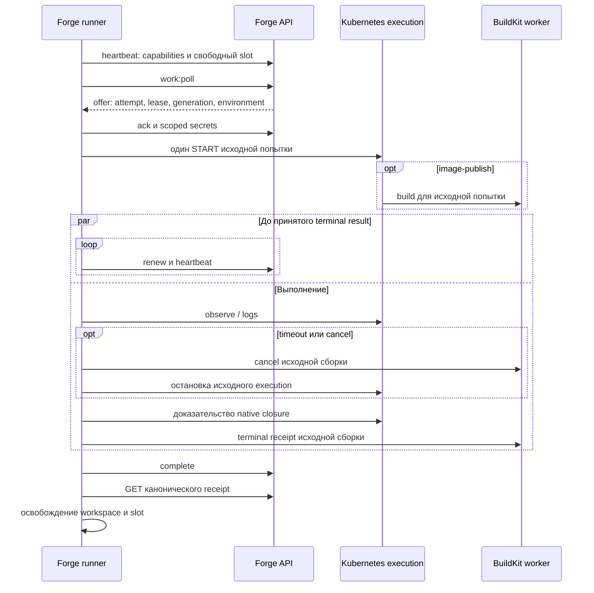

# Последовательность выполнения внешнего runner

Недоступное или неизвестное состояние сохраняет custody. После потери ответа
сначала выполняется readback; START и внешние действия не повторяются.
Контракт и границы совместимости: [Runner protocol](../../contracts/RUNNER_PROTOCOL.md).
