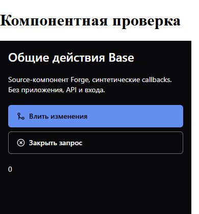

# Вертикальные действия Forge

Source leaf PullRequestActions использует ActionGroup Base с синтетическими
callbacks. Это отдельная компонентная проверка, не установленное приложение:
API, Auth, runtime и пользовательские данные не использовались.

Dark, фактическая ширина iframe375px; кнопки343×44px. Проверены также
light/gray и320/1920/2560px, горизонтальный режим, отсутствие overflow,
Escape/возврат focus и один callback после подтверждения.

